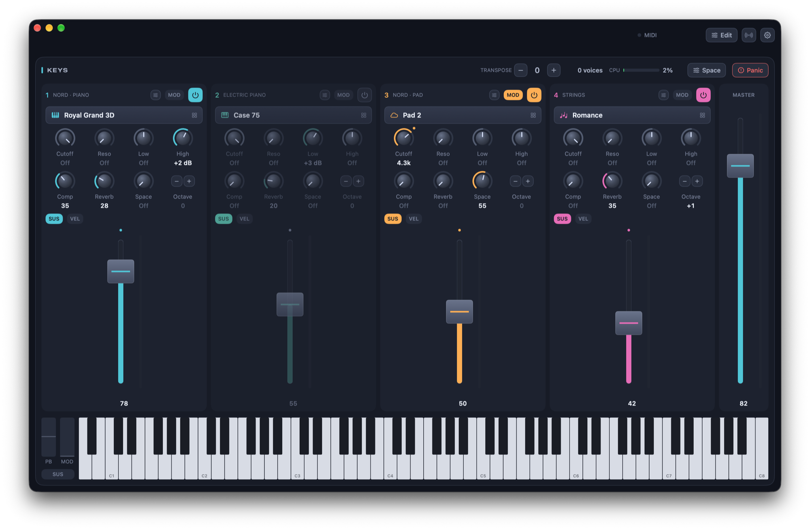
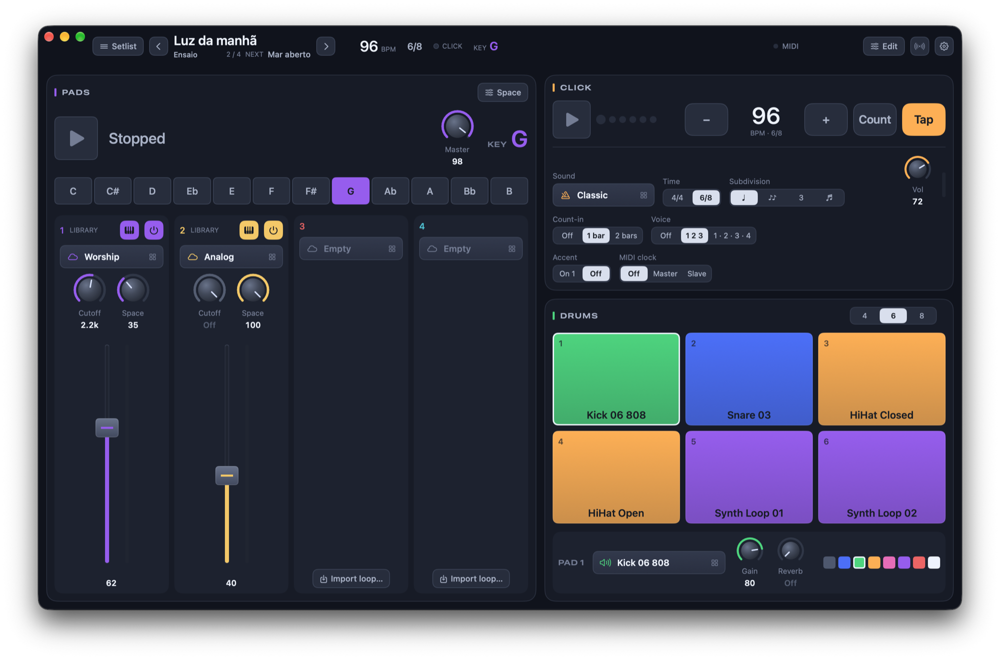

# StageKeys

Two small macOS apps for playing keyboard live. A hobby project, made to help a few friends who play keys.

- **StageKeys**: the sounds of your keyboard. Up to four SF2 layers, each with volume, filter, compressor, reverb and space. Every knob and button can be mapped to MIDI, and sounds come from an online library.
- **StageKeys Play**: what plays along with you. Setlist with tempo, time signature and key, continuous pads in any key, click with count-in and tap tempo, and drum pads with loops and samples.

Site: [stagekeys.com.br](https://stagekeys.com.br)




## Download

Get the `.dmg` files from the [latest release](https://github.com/renatoruis/stagekeys/releases/latest). macOS 14 or later.

The apps are not on the App Store, but they are signed and notarized by Apple, so macOS opens them normally.

## Building

Developed with Xcode 26.

```sh
open StageKeys/StageKeys.xcodeproj
open StageKeysPlay/StageKeysPlay.xcodeproj
```

Code shared by both apps lives in `Shared/`.

StageKeys lists and downloads `.sf2` files from the URL in `StageKeysSoundsURL` (`StageKeys/StageKeys/Info.plist`). During development, set `STAGEKEYS_SOUNDS` to a local folder of `.sf2` files instead. File names follow `Category - Name.sf2` or `Category - Subcategory - Name.sf2`; `StageKeys/scripts/check-sound-names.py` checks a folder before upload.

The site in `site/` is a static page deployed with Cloudflare Workers (`npx wrangler deploy`).

## Contributing

Issues and pull requests are welcome. Keep changes small and focused, and follow the style of the code around them.

## License

[MIT](LICENSE). Valhalla Supermassive (`*/Plugins/ValhallaSupermassive.component`) is a free plugin by [Valhalla DSP](https://valhalladsp.com) and is not covered by this license.
