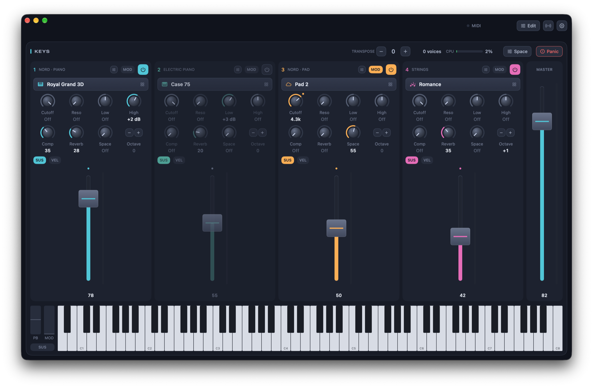
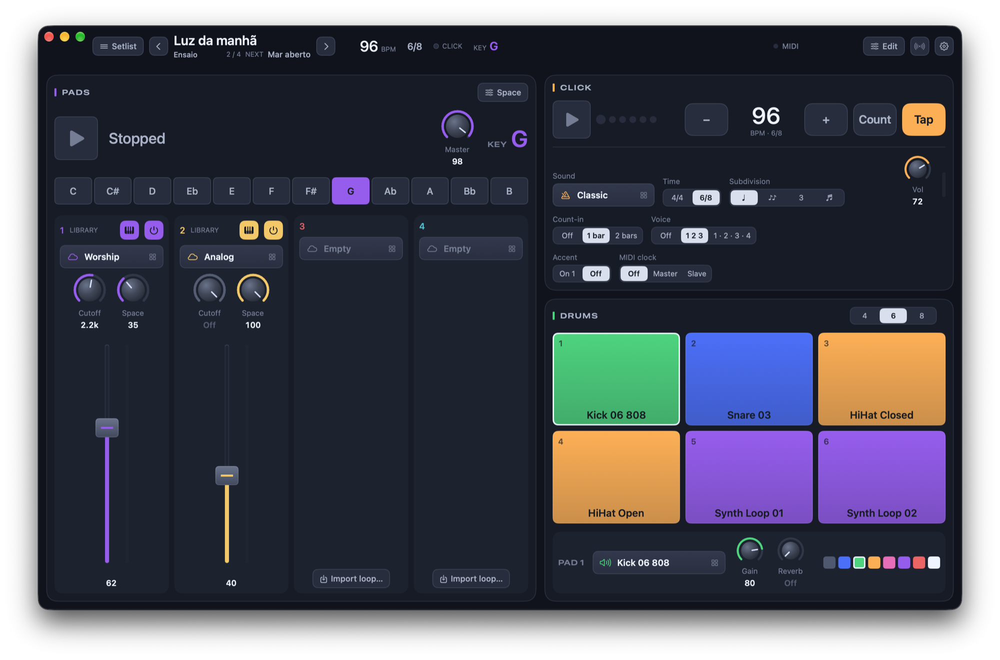

# StageKeys

One macOS app for playing keyboard live. A hobby project, made to help a few friends who play keys.

Two tabs. Both audio engines stay running; the tab only changes the screen.

- **Show**: setlist with tempo, time signature and key, continuous pads in any key, click with count-in and tap tempo, and drum pads.
- **Keys**: up to four SF2 layers, each with volume, filter, compressor and reverb.

Every knob and button can be mapped to MIDI. Switch tabs with ⌘1 and ⌘2, or a MIDI binding. Sounds come from an online library.

Site: [stagekeys.com.br](https://stagekeys.com.br)




## Download

Get the `.dmg` from the [latest release](https://github.com/renatoruis/stagekeys/releases/latest). macOS 14 or later.

The app is not on the App Store, but it is signed and notarized by Apple, so macOS opens it normally.

## Building

Developed with Xcode 26.

```sh
open StageKeys/StageKeys.xcodeproj
```

StageKeys lists and downloads `.sf2` files from the URL in `StageKeysSoundsURL` (`StageKeys/StageKeys/Info.plist`). During development, set `STAGEKEYS_SOUNDS` to a local folder of `.sf2` files instead. Set `STAGEKEYS_RESOURCES` to a folder that contains `Pads` when the bundled `StageLibrary` is not the one you want. File names follow `Category - Name.sf2` or `Category - Subcategory - Name.sf2`; `StageKeys/scripts/check-sound-names.py` checks a folder before upload.

The site in `site/` is a static page deployed with Cloudflare Workers (`npx wrangler deploy`).

## Contributing

Issues and pull requests are welcome. Keep changes small and focused, and follow the style of the code around them.

## License

[MIT](LICENSE).
